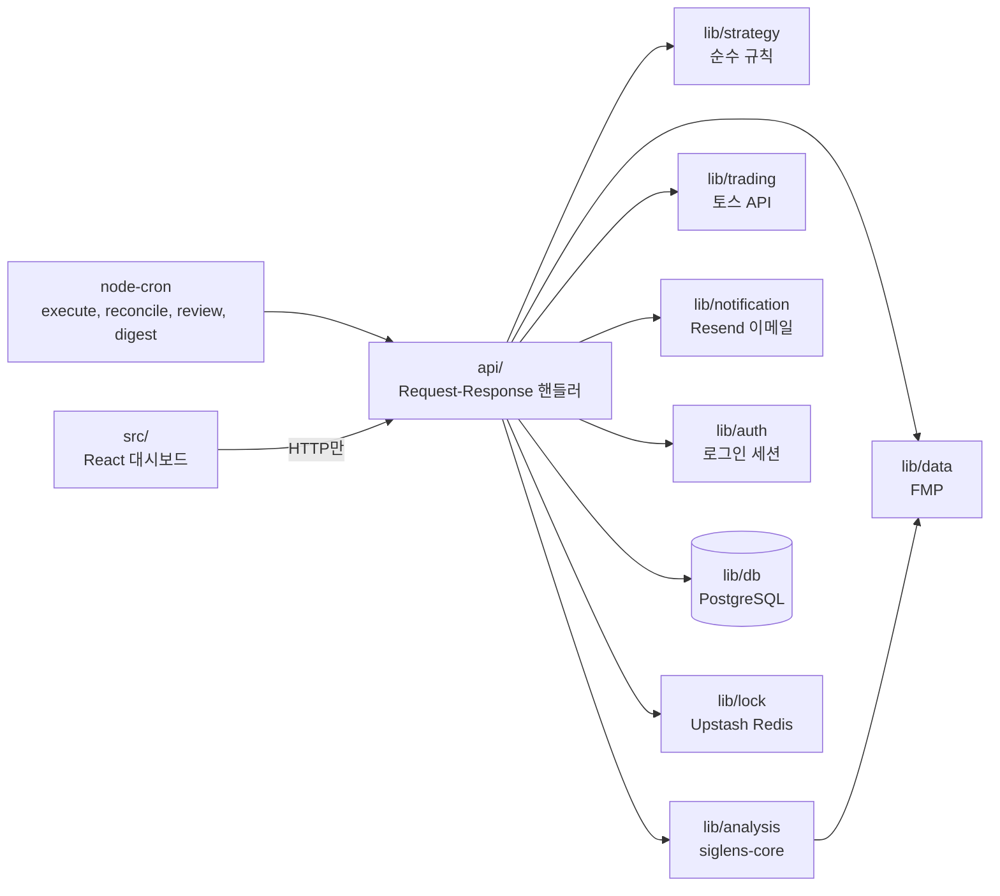

# siglens-trader

<div align="center">

**토스증권 Open API로 미국 주식을 자동매매하는 TypeScript 오픈소스: RSI(2) 평균회귀(눌림목) 전략, 모의 실행(dry run), 백테스트 동등성.**

개인용 주식 자동매매 시스템입니다. 일봉 규칙 하나, 엄격한 리스크 통제, 기록만 남기고 주문은 바꾸지 않는 AI 리뷰로 이루어져 있습니다.

[](./LICENSE)
[](./Dockerfile)

[](https://siglens.io)
[](https://github.com/y0ngha/siglens)
[](https://github.com/y0ngha/siglens-core)
[](./README.md)

</div>

---

> **개인용입니다. 투자 조언이 아닙니다.** 이 프로젝트는 서비스가 아니며 다른 사람에게 제공하지 않습니다. 매매에는 손실 위험이 따르며, 이 코드를 사용한 결과의 책임은 전적으로 사용자에게 있습니다.

## 무엇인가

siglens-trader는 [SIGLENS](https://github.com/y0ngha/siglens)의 자동매매 사이드 프로젝트입니다. 토스증권을 통해 미국 주식을 매매하며, 가격만 보는 결정론적 규칙 하나를 씁니다. 상승 추세인 종목의 눌림목을 사는 **일봉 RSI(2) 평균회귀 매수**이고, 청산 규칙도 고정되어 있습니다. 같은 입력에는 항상 같은 판단이 나옵니다.

[`@y0ngha/siglens-core`](https://github.com/y0ngha/siglens-core)의 AI 분석은 신호가 난 종목에 대해서만 실행됩니다. **기록 전용 리뷰**라서 나중에 살펴볼 수 있도록 거래와 함께 저장될 뿐, 주문을 바꾸지 않습니다.

주문은 설정한 매매 모드에 따라 나갑니다.

| 모드 | 동작 |
|---|---|
| `dry_run` | 실제 주문 없음. 모의 투자 거래만 DB에 기록합니다. 기본값입니다. |
| `semi_auto` | 신호가 나면 이메일로 알리고, 대시보드에서 승인 또는 거절합니다. 대기 주문은 15분 뒤 또는 장 마감 중 먼저 오는 시각에 만료되며, 만료되면 주문은 나가지 않습니다. |
| `auto` | 즉시 실제 주문을 냅니다. 실제 돈이 오갑니다. |

증권사는 토스증권(Open API)입니다. 토스증권 Open API 약관은 거래 데이터를 개인 용도로만 쓰도록 제한하므로, 이 코드를 직접 돌리려면 본인 계정을 쓰고 약관을 직접 확인해야 합니다. 이 저장소는 투명성을 위해 공개했을 뿐 서비스로 제공하지 않습니다.

## 전략을 쉽게 말하면

- **평균회귀(눌림목 매수)**: 상승 추세인 주식이 단기간에 급하게 떨어지면 최근 평균 가격 쪽으로 되돌아오는 경우가 많습니다. 이 규칙은 그 눌림목에서 사서 반등에서 파는 방식입니다.
- **RSI(2)**는 2일 RSI입니다. 흔히 쓰는 14일 RSI보다 훨씬 민감해서, 10 미만이라면 최근 이틀 사이 아주 급하게 떨어졌다는 뜻입니다.
- **언제 사나**: 종가가 200일 이동평균선 위(상승 추세)에 있고 RSI(2)가 10 미만일 때입니다. 하루에 한 번, 미국 장 마감 직전 20분 안에 확인합니다. 신호가 자금보다 많으면 RSI(2)가 낮은 종목부터 삽니다. 한 종목에 한 포지션만 두며 물타기는 없습니다.
- **언제 파나(청산, 전량)**: 가격이 5일 이동평균선 위로 오르거나, 10거래일이 지나거나, 비상 손절에 닿을 때입니다.
- **시장 필터(기본 켜짐)**: SPY(S&P 500 ETF)가 자신의 200일선 아래면 신규 매수를 하지 않습니다.
- **AI는 매매를 결정하지 않습니다.** AI 리뷰는 나중에 살펴보도록 저장만 합니다.

위 숫자는 모두 기본값이며 설정에서 바꿀 수 있습니다(`mr_rsi_entry`, `mr_max_hold_days`, `mr_stop_atr`, `mr_regime_filter`).

## 위험과 한계

- **손절폭을 일부러 넓게 잡았습니다.** 비상 손절(대형 급락 대비 안전장치)은 진입가 − 10 × ATR(14)(`mr_stop_atr`)에 걸립니다. 촘촘한 손절이 아니라 큰 폭락에 대비한 최후의 안전장치라서, 손절에 닿기 전까지 한 종목에서 큰 손실이 날 수 있습니다.
- **포지션 크기는 칸 수로 제한됩니다.** 계좌를 최대 8칸(동시 보유 종목 수)으로 나누고 한 포지션은 한 칸 크기로 잡습니다. 그래서 한 포지션의 최악의 경우는 그 칸에 배정된 금액입니다.
- **백테스트 결과가 미래 수익을 보장하지 않습니다.**
- **먼저 `dry_run`으로 시작하세요.** `auto`는 실제 돈으로 실제 주문을 냅니다.
- `semi_auto`의 승인 대기는 위에서 설명한 대로 만료되며, 만료된 승인은 주문을 내지 않습니다.

## 기능

### 전략과 신호

- 진입: 가격이 200일선 위이고 RSI(2)가 `mr_rsi_entry`(기본 10) 미만일 때, 기본적으로 SPY가 자신의 200일선 위일 때만 진입합니다. 신호가 예산보다 많으면 RSI(2)가 낮은 순입니다.
- 청산(전량): 가격이 5일선 위로 오르거나, 최대 보유 기간(`mr_max_hold_days`, 기본 10거래일)을 채우거나, 진입가 − `mr_stop_atr`(기본 10) × ATR(14)의 비상 손절에 닿을 때입니다.
- 판단은 장 마감 전 20분 창에서 하루 한 번 내립니다. 매 틱 확인하는 것은 비상 손절뿐입니다.
- 전략 코드는 I/O 없는 순수 함수이며, 백테스트 스크립트와 동등성 테스트로 고정되어 있습니다.

### 리스크 통제

- **거래 중지 스위치**: `trading_enabled=false`면 청산을 포함해 전부 멈춥니다.
- **한도는 신규 매수에만 적용**: 일일 거래 한도(`max_trades_per_day`, 기본 20), 일일 손실 한도, 종목별·총 노출 상한은 신규 매수만 막습니다. 매도까지 막으면 오히려 위험이 커지므로, 한도는 신규 매수에만 적용됩니다.
- **총자산 연동 사이징**: 칸 수(최대 8)와 금액 한도는 손으로 정하지 않고 매 실행마다 계좌 총자산에서 계산합니다.
- **시장 국면 필터**: 기본적으로 SPY가 200일선 아래면 신규 매수를 막는 하드 필터(`mr_regime_filter`)가 켜져 있습니다. 선택 기능인 소프트 캡(`mr_soft_regime_enabled`, 기본 꺼짐)은 SPY가 50일선 이하일 때 동시 보유 종목 수를 제한합니다(기본 4).

### 주문 실행과 복구

- 주문마다 중복 주문 방지 키를 쓰고, `order_tracking` 테이블이 제출, 체결, 거절, 타임아웃을 추적합니다.
- 거래와 포지션 변경은 하나의 DB 트랜잭션으로 기록합니다.
- 주문·체결 대조 작업이 미체결 주문을 타임아웃 처리하고, 불일치를 자동 복구하며, DB 정합성을 검사합니다.
- 분산 락(Upstash Redis)으로 겹친 실행이 중복 매매하지 않게 합니다.

### AI 리뷰

신호마다 기술·뉴스·펀더멘털 분석과 AI 판단을 감사 기록에 남깁니다. 리뷰가 주문을 바꾸는 일은 없습니다.

### 알림

Resend로 이메일을 보내며, 이벤트별(체결, 승인 대기, 손절, 시스템 오류, 이상 감지)로 켜고 끌 수 있습니다. 알림 금지 시간대에 생긴 알림은 큐에 쌓였다가 한 통의 요약 메일로 발송됩니다.

### 대시보드와 예약 작업

앱 자체 로그인 뒤의 React 대시보드(상태, 포지션, 거래, 승인 대기, 분석, cron 실행 기록, 설정)가 있습니다. 가입 기능은 없고, 유일한 계정은 CLI 스크립트로 만듭니다. 인프로세스 cron 작업 네 가지(execute, reconcile, digest(요약 메일), review)가 돕니다.

## 제품 화면

<p align="center">
  
  
  
  
  
  
</p>

화면은 `yarn db:seed`의 데모 데이터로 찍었기 때문에 현재 UI와 일부 표기가 다를 수 있습니다.

## 동작 구조



- `api/`는 Web 표준 `Request`→`Response` 핸들러와 cron 흐름이고, `server/`는 이를 마운트하고 빌드된 대시보드를 서빙하며 작업을 인프로세스로 예약하는 Hono 진입점입니다.
- `lib/strategy/`는 순수한 규칙과 사이징 로직으로, I/O를 하지 않습니다.
- `lib/trading/`은 토스증권 클라이언트입니다. 이 쪽을 바꿔도 전략을 바꿀 필요가 없습니다.
- `lib/data/`는 가격과 뉴스(FMP)를 가져옵니다.
- `lib/analysis/`는 신호 종목의 리뷰를 위해 `lib/data/`를 쓰며 `@y0ngha/siglens-core`를 호출합니다.
- `lib/notification/`은 이메일 발송, `lib/auth/`는 로그인 세션을 맡습니다.
- `lib/db/`는 Drizzle ORM을 통한 PostgreSQL이고, `lib/lock.ts`는 Redis 락입니다.
- `src/`는 대시보드이며 API로만 통신합니다. `lib/`를 import하지 않습니다.

## 시작하기

준비물: Node.js 22, Yarn 4(`package.json`에 고정), PostgreSQL 데이터베이스, Upstash Redis 인스턴스, FMP API 키. localhost가 아닌 데이터베이스 호스트는 인증서 검증을 거치는 TLS가 필수입니다.

`@y0ngha/siglens-core`는 GitHub Packages로 배포되므로 `yarn install`에는 `read:packages` 스코프의 GitHub 토큰이 `SIGLENS_GITHUB_TOKEN`에 필요합니다(`.yarnrc.yml`이 읽습니다).

```bash
export SIGLENS_GITHUB_TOKEN=...   # 본인 토큰
yarn install
cp .env.example .env.local        # 아래 변수를 채웁니다(CRON_SECRET 포함)
yarn db:migrate
yarn db:seed-operator             # 유일한 로그인 계정 생성
yarn build && yarn start          # API + 스케줄러 + 대시보드: http://localhost:3000
```

`yarn start`는 `PORT`(기본 3000)에서 대기합니다. `yarn dev`(Vite, 6270 포트)와 `yarn dev:mock`(Mock Service Worker, 백엔드 없음)은 UI 작업용입니다. `yarn dev`는 `/api/search`만 프록시하므로 대시보드의 다른 API 호출은 실패합니다.

### 감시 종목과 데모 데이터

감시할 종목이 없으면 모의 실행(dry run)에서도 신호가 나오지 않습니다. 대시보드의 **설정 → 감시 종목**에서 추가하세요(심볼 또는 회사명으로 검색, 최대 50개).

`yarn db:seed`는 선택 사항이며 데모 데이터를 씁니다. 기본 설정, 감시 종목 5개, 가짜 포지션·거래·분석 결과·승인 대기 주문, 알림 수신 대상이 들어갑니다. 실제로 쓰기 전에 `yarn db:clear`(확인을 묻고, 설정을 포함해 모든 테이블을 지웁니다)를 실행하거나, 시드를 건너뛰고 종목을 직접 추가하세요.

### 직접 실행해 보기

`CRON_SECRET`이 없으면 스케줄러가 아예 돌지 않고, 프로덕션에서는 서버가 부팅을 거부합니다. 작업을 손으로 실행할 수도 있습니다.

```bash
curl -H "Authorization: Bearer $CRON_SECRET" http://localhost:3000/api/cron/execute
```

매수·매도 판단은 미국 거래일(공휴일이 아닌 평일)의 장 마감 직전 20분 안에서만 내려집니다. 정규장 밖에서 호출하면 `market_closed`가 돌아옵니다.

로컬 `dry_run` 실행에 필요한 변수입니다(전체는 `.env.example` 참고, 실제 값은 절대 커밋하지 마세요).

| 변수 | 용도 |
|---|---|
| `DATABASE_URL` | PostgreSQL 연결 문자열 |
| `UPSTASH_REDIS_REST_URL`, `UPSTASH_REDIS_REST_TOKEN` | 분산 락과 캐시 |
| `FMP_API_KEY`, `MARKET_DATA_PROVIDER` | 시장 데이터 |
| `DEEPSEEK_API_KEY`(또는 선택한 모델의 키) | AI 리뷰. `ANTHROPIC_API_KEY`, `GEMINI_API_KEY`, `OPENAI_API_KEY`도 가능 |
| `CRON_SECRET` | cron 엔드포인트를 보호하고 스케줄러를 켭니다. 프로덕션에서는 없으면 서버가 부팅하지 않습니다 |
| `OPERATOR_EMAIL`, `OPERATOR_PASSWORD` | `yarn db:seed-operator`만 읽음 |
| `DISABLE_AUTH` | 로컬에서 `true`로 두면 로그인 생략(프로덕션에서는 무시) |
| `SIGLENS_GITHUB_TOKEN` | `yarn install`에 필요 |

`TOSS_APP_KEY`, `TOSS_SECRET_KEY`는 `semi_auto`와 `auto`에서만, `RESEND_API_KEY`와 `NOTIFICATION_EMAIL_FROM`은 이메일 발송에만 필요합니다.

| 스크립트 | 용도 |
|---|---|
| `yarn build && yarn start` | 전체 로컬 실행: API, 스케줄러, 대시보드 |
| `yarn dev`, `yarn dev:mock` | 대시보드 UI 작업 전용 |
| `yarn test`, `yarn test:coverage` | Vitest |
| `yarn lint`, `yarn lint:style`, `yarn format:check` | ESLint, Stylelint, Prettier |
| `yarn typecheck` | TypeScript |
| `yarn db:generate`, `db:migrate`, `db:seed`, `db:seed-operator`, `db:clear` | 데이터베이스 |

## 문서

- [CLAUDE.md](./CLAUDE.md): 개요, 레이어 규칙, 설계 원칙. 각 디렉터리에도 불변식을 적은 `CLAUDE.md`가 있습니다.
- [openapi.json](./openapi.json): HTTP API 명세
- [CHANGELOG.md](./CHANGELOG.md): 릴리스 기록

## 기여

개인 프로젝트입니다. 이슈는 환영하지만 풀 리퀘스트는 받아들여지지 않을 수 있습니다.

## 보안

취약점은 공개 이슈로 제보하지 마세요. [GitHub Security Advisories](https://github.com/y0ngha/siglens-trader/security/advisories/new)로 비공개 제보해 주세요.

## 면책 고지

이 소프트웨어는 사용자가 정한 설정에 따라 자동으로 매매를 실행합니다. 모든 투자 판단, 설정값 구성, 자동 매매 실행과 그 결과에 대한 책임은 사용자 본인에게 있습니다. 과거 백테스트 결과는 미래 수익을 보장하지 않습니다. 작성자는 투자 손실이나 기타 불이익에 대해 책임을 지지 않으며, 여기 있는 어떤 내용도 투자 조언이 아닙니다.

## 라이선스

[MIT License](./LICENSE) © 2026 y0ngha
