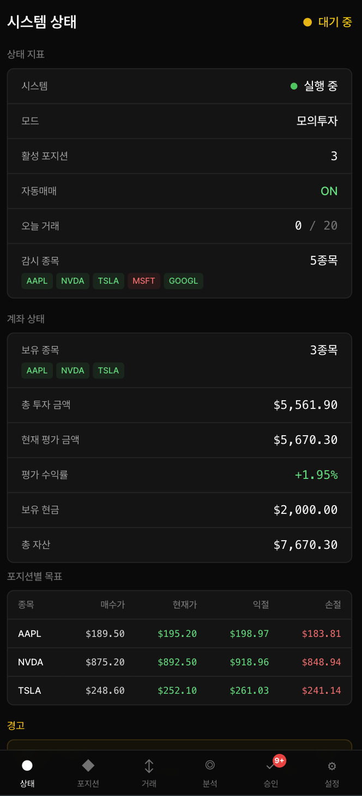
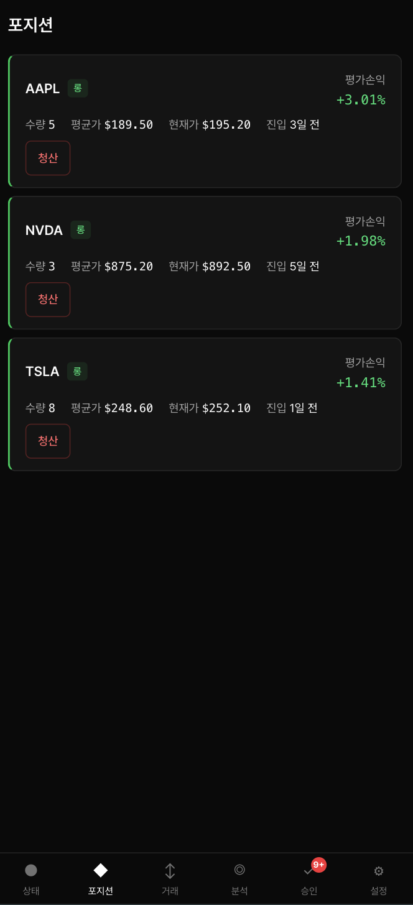
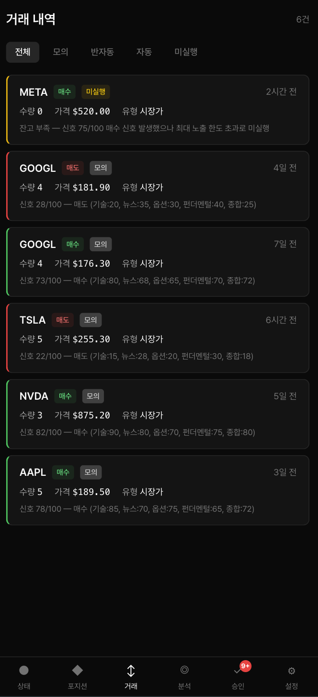
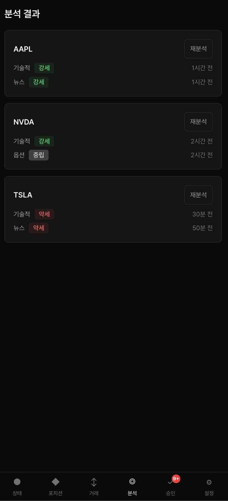
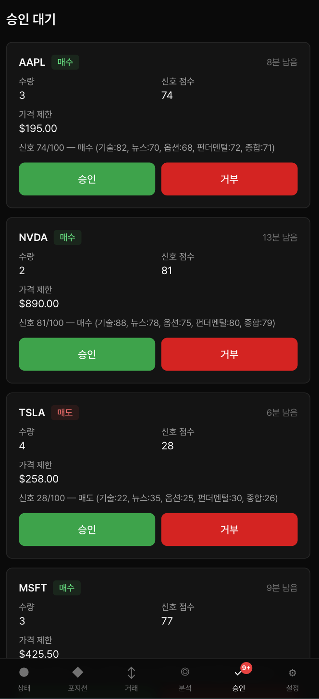
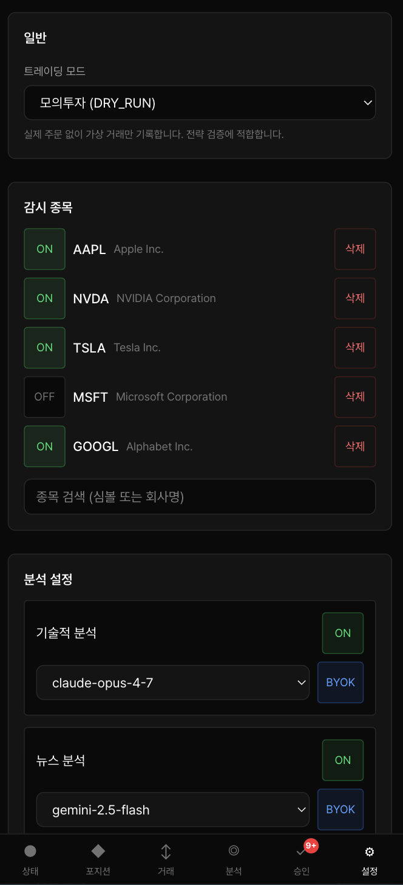
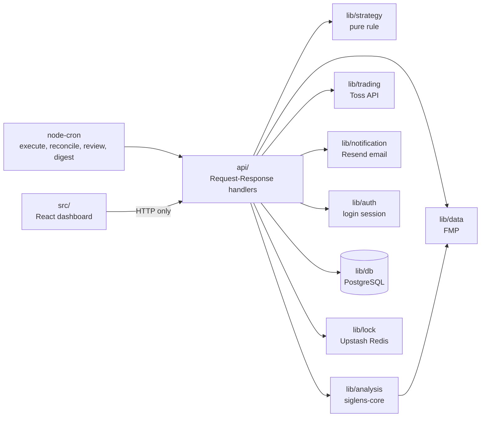

# siglens-trader

<div align="center">

**A TypeScript algorithmic trading bot for US stocks via the Toss Securities Open API: RSI(2) mean reversion, paper trading (dry run), and backtest parity.**

A personal auto-trading system: one daily rule, strict risk controls, and AI review that is recorded but never moves an order.

[](./LICENSE)
[](./Dockerfile)

[](https://siglens.io)
[](https://github.com/y0ngha/siglens)
[](https://github.com/y0ngha/siglens-core)
[](./README.ko.md)

</div>

---

> **For personal use only. Not investment advice.** This is not a service and is not offered to anyone else. Trading involves risk of loss, and you are solely responsible for any use of this code.

## What it is

siglens-trader is the auto-trading side project of [SIGLENS](https://github.com/y0ngha/siglens). It trades US stocks through Toss Securities with one deterministic, price-only rule: a **daily RSI(2) mean-reversion** entry (buy a pullback while the uptrend is intact) with fixed exit rules. The same inputs always give the same decision.

AI analysis from [`@y0ngha/siglens-core`](https://github.com/y0ngha/siglens-core) runs only for symbols that produced a signal. It is a **record-only review**: it is stored next to the trade for later study and never changes an order.

Orders are placed according to the configured trading mode:

| Mode | Behavior |
|---|---|
| `dry_run` | No real orders. Simulated trades are recorded in the database. This is the default. |
| `semi_auto` | A signal sends an email; you approve or reject it in the dashboard. A pending order expires after 15 minutes or at the market close, whichever comes first, and then no order is placed. |
| `auto` | Orders are sent immediately, with real money. |

The brokerage is Toss Securities (Open API). The Toss Open API terms restrict trading data to personal use, so anyone running this code must use their own account and check the terms themselves. This repository is public for transparency; it is not offered as a service.

## The strategy in plain words

- **Mean reversion ("buy the dip")**: after a sharp short-term drop, a stock in an uptrend often bounces back toward its recent average. The rule tries to buy that dip and sell the bounce.
- **RSI(2)** is the 2-day RSI. It reacts far faster than the usual 14-day RSI, so a reading below 10 means a very sharp drop over the last couple of days.
- **When it buys**: the stock closes above its 200-day moving average (an uptrend) and its RSI(2) is below 10. The check happens once a day, in the last 20 minutes before the US market closes. If there are more signals than money, the lowest RSI(2) goes first. One position per symbol, no averaging down.
- **When it sells (exit, whole position)**: the price rises above its 5-day moving average, or 10 trading days have passed, or the emergency stop is hit.
- **Market filter, on by default**: no new buys while SPY (the S&P 500 ETF) is below its own 200-day average.
- **The AI never decides trades.** Its review is stored for later study only.

All numbers are defaults you can change in Settings (`mr_rsi_entry`, `mr_max_hold_days`, `mr_stop_atr`, `mr_regime_filter`).

## Risks and limits

- **The stop is wide on purpose.** The emergency stop sits at entry price minus 10 × ATR(14) (`mr_stop_atr`). It is a safety net for a huge crash, not a tight stop-loss, so a single position can lose a lot before it triggers.
- **Position size is capped by slots.** The account is split into at most 8 slots (the number of positions held at once), and one position is sized to one slot. The worst case for a single position is therefore that slot's allocation.
- **Backtests do not guarantee future results.**
- **Start with `dry_run`.** `auto` sends real orders with real money.
- `semi_auto` approvals expire as described above; an expired approval places no order.

## Features

### Strategy and signals

- Entry: price above its 200-day average and RSI(2) below `mr_rsi_entry` (default 10), by default only while SPY is above its own 200-day average. The lowest RSI(2) wins when signals exceed the budget.
- Exit (whole position): price above the 5-day average, a maximum holding period (`mr_max_hold_days`, default 10 trading days), or the emergency stop at entry price minus `mr_stop_atr` (default 10) times ATR(14).
- The decision runs once a day in the 20 minutes before the close. Only the emergency stop is checked on every tick.
- The strategy code is pure functions with no I/O and is pinned to the backtest script by an equivalence test.

### Risk controls

- **Trading kill switch**: `trading_enabled=false` stops everything, exits included.
- **Limits apply to new buys only**: the daily trade limit (`max_trades_per_day`, default 20), the daily loss limit, and per-symbol and total exposure caps block new buys. Blocking sells as well would raise the risk, so exits are never blocked by them.
- **Equity-scaled sizing**: the number of slots (up to 8) and the dollar limits are derived from account equity on every run, not set by hand.
- **Market regime filters**: by default a hard filter blocks new buys when SPY is below its 200-day average (`mr_regime_filter`). An optional soft cap (`mr_soft_regime_enabled`, off by default) limits the number of concurrently held positions (default 4) while SPY is at or below its 50-day average.

### Order execution and recovery

- A duplicate-order prevention key per order and an `order_tracking` table covering submitted, filled, rejected, and timeout.
- Trade and position changes are written in one database transaction.
- An order and fill reconciliation job times out unfilled orders, repairs inconsistencies automatically, and checks database consistency.
- A distributed lock (Upstash Redis) keeps overlapping runs from trading twice.

### AI review

For each signal, technical, news, and fundamental analysis plus an AI judgement are stored in the audit trail. Reviews never alter an order.

### Notifications

Email through Resend, with per-event on/off switches (fills, pending approvals, stop-outs, system errors, anomalies). Alerts raised during quiet hours (a no-notification window) are queued and sent as one summary email.

### Dashboard and scheduled jobs

A React dashboard (status, positions, trades, pending approvals, analysis, cron runs, settings) behind the app's own login. There is no signup; the single account is created by a CLI script. Four in-process cron jobs run: execute, reconcile, digest (summary email), and review.

## Screenshots

<p align="center">
  
  
  
  
  
  
</p>

The screenshots are from the demo data of `yarn db:seed`, so some labels may differ from the current UI.

## How it works



- `api/` holds Web-standard `Request` to `Response` handlers and the cron flows; `server/` is the Hono entry point that mounts them, serves the built dashboard, and schedules the jobs in-process.
- `lib/strategy/` is the pure rule and sizing logic. It performs no I/O.
- `lib/trading/` is the Toss Securities client; changing it never requires changing the strategy.
- `lib/data/` fetches prices and news (FMP).
- `lib/analysis/` calls `@y0ngha/siglens-core` for the review of signalled symbols, using `lib/data/`.
- `lib/notification/` sends email; `lib/auth/` handles the login session.
- `lib/db/` is PostgreSQL through Drizzle ORM; `lib/lock.ts` is the Redis lock.
- `src/` is the dashboard and talks to the API only; it never imports `lib/`.

## Getting started

Prerequisites: Node.js 22, Yarn 4 (pinned in `package.json`), a PostgreSQL database, an Upstash Redis instance, and an FMP API key. A database host other than localhost requires certificate-verified TLS.

`@y0ngha/siglens-core` is published to GitHub Packages, so `yarn install` needs a GitHub token with the `read:packages` scope in `SIGLENS_GITHUB_TOKEN` (read by `.yarnrc.yml`).

```bash
export SIGLENS_GITHUB_TOKEN=...   # your own token
yarn install
cp .env.example .env.local        # then fill in the variables below (set CRON_SECRET)
yarn db:migrate
yarn db:seed-operator             # creates the single login account
yarn build && yarn start          # API + scheduler + dashboard on http://localhost:3000
```

`yarn start` listens on `PORT` (default 3000). `yarn dev` (Vite on port 6270) and `yarn dev:mock` (Mock Service Worker, no backend) are for UI work only: `yarn dev` proxies just `/api/search`, so the dashboard's other API calls fail.

### Watchlist and demo data

A dry run produces no signals until there are symbols to watch. Add them in the dashboard under **Settings → watchlist** (search by symbol or company name; up to 50).

`yarn db:seed` is optional and writes demo data: default settings, five watchlist symbols, mock positions, trades, analysis results, and pending orders, plus a notification target. Run `yarn db:clear` (it asks for confirmation and deletes all tables, settings included) before real use, or skip the seed and add symbols by hand.

### Triggering a run

Without `CRON_SECRET` the scheduler does not run at all, and in production the server refuses to boot without it. You can also trigger a job by hand:

```bash
curl -H "Authorization: Bearer $CRON_SECRET" http://localhost:3000/api/cron/execute
```

Buy and sell decisions are only made on US trading days (weekdays that are not market holidays), in the last 20 minutes before the close. Outside the regular session the call returns `market_closed`.

Variables needed to run locally in `dry_run` (see `.env.example` for all of them; never commit real values):

| Variable | Purpose |
|---|---|
| `DATABASE_URL` | PostgreSQL connection string |
| `UPSTASH_REDIS_REST_URL`, `UPSTASH_REDIS_REST_TOKEN` | Distributed lock and caches |
| `FMP_API_KEY`, `MARKET_DATA_PROVIDER` | Market data |
| `DEEPSEEK_API_KEY` (or the key of the model you select) | AI review; also `ANTHROPIC_API_KEY`, `GEMINI_API_KEY`, `OPENAI_API_KEY` |
| `CRON_SECRET` | Gates the cron endpoints and enables the scheduler; the server will not boot in production without it |
| `OPERATOR_EMAIL`, `OPERATOR_PASSWORD` | Read only by `yarn db:seed-operator` |
| `DISABLE_AUTH` | Set to `true` locally to skip login (ignored in production) |
| `SIGLENS_GITHUB_TOKEN` | Needed by `yarn install` |

`TOSS_APP_KEY` and `TOSS_SECRET_KEY` are needed only for `semi_auto` and `auto`; `RESEND_API_KEY` and `NOTIFICATION_EMAIL_FROM` only for email.

| Script | Purpose |
|---|---|
| `yarn build && yarn start` | Full local run: API, scheduler, dashboard |
| `yarn dev`, `yarn dev:mock` | Dashboard UI work only |
| `yarn test`, `yarn test:coverage` | Vitest |
| `yarn lint`, `yarn lint:style`, `yarn format:check` | ESLint, Stylelint, Prettier |
| `yarn typecheck` | TypeScript |
| `yarn db:generate`, `db:migrate`, `db:seed`, `db:seed-operator`, `db:clear` | Database |

## Documentation

- [CLAUDE.md](./CLAUDE.md): overview, layer rules, and design principles; each directory has its own `CLAUDE.md` with its invariants.
- [openapi.json](./openapi.json): the HTTP API description.
- [CHANGELOG.md](./CHANGELOG.md): release history.

## Contributing

This is a personal project. Issues are welcome; pull requests may not be accepted.

## Security

Please do not report a vulnerability in a public issue. Report it privately through [GitHub Security Advisories](https://github.com/y0ngha/siglens-trader/security/advisories/new).

## Disclaimer

This software executes trades automatically according to settings you choose. Every investment decision, configuration, automated execution, and its result is your own responsibility. Past backtest results do not guarantee future returns. The author accepts no liability for losses or other disadvantages. Nothing here is investment advice.

## License

[MIT License](./LICENSE) © 2026 y0ngha
